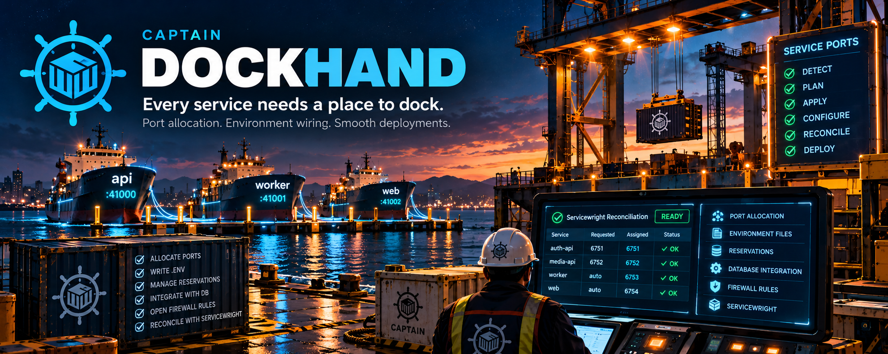

# Captain Dockhand

<p align="center">
  
</p>

**Every service needs a place to dock.**

Dockhand is a lightweight, standalone Python CLI for **allocating runtime ports and wiring service environments**. It can reserve or reuse ports, write `.env` settings, maintain a JSON reservation file, and prepare resolved service configuration for [Servicewright](https://github.com/captain-cli/servicewright).

Dockhand belongs to the Captain tool family, but **does not require Captain**.

**Status:** v0.2.0 · Alpha · Python 3.10+

## What Dockhand does

```text
Project manifest
      │
      ▼
Validate → Plan (no writes) → Apply (requested writes)
                                │
                                ├── Port reservations
                                ├── .env assignments
                                └── Optional DB / firewall integration

Servicewright configuration
      │
      ▼
Dockhand reconcile → resolved config + per-service .env
      │
      ▼
Servicewright generate → systemd units
```

| Capability | Purpose |
| --- | --- |
| **Validate** | Check a manifest before making changes |
| **Plan** | Preview port assignments without writing files or changing the firewall |
| **Apply** | Reserve/reuse ports and write explicitly requested outputs |
| **Reconcile** | Preserve available service ports, resolve conflicts, and prepare Servicewright inputs |
| **Integrate** | Optionally use MySQL/MariaDB settings or firewall rules |

## Quick start: inspect without changing your system

From a clone of this repository:

```bash
git clone https://github.com/captain-cli/dockhand.git
cd dockhand
python3 -m venv .venv
source .venv/bin/activate
python -m pip install -e ".[test]"

dockhand --version
pytest -q
dockhand ports validate --config examples/dockhand.json
dockhand ports plan --config examples/dockhand.json --json
```

The last two commands **validate and plan only**; they do not write reservation or environment files, update a database, or open firewall ports.

### Example: three services, three ports

The included `examples/dockhand.json` describes the `crispy-metadata-enrichment` project. In a successful dry run, it can assign:

| Service | Example port | Environment variable |
| --- | ---: | --- |
| `metadata-api` | `41000` | `CRISPY_METADATA_ENRICHMENT_METADATA_API_PORT` |
| `video-analysis` | `41001` | `CRISPY_METADATA_ENRICHMENT_VIDEO_ANALYSIS_PORT` |
| `worker` | `41002` | `WORKER_SOCKET_PORT` |

These are **example results**, not guaranteed ports on every host. Existing reservations and port availability affect assignments.

## Start a project

Generate a starter manifest:

```bash
dockhand init --project-name my-project --output manifest/dockhand.json
```

Typical layout:

```text
my-project/
  manifest/dockhand.json
  config/reserved-ports.json   # created when used
  .env                         # created/updated when requested
```

A manifest describes the project, preferred port range, environment output, reservation file, and applications. See [`examples/dockhand.json`](./examples/dockhand.json) for a working example.

Run the lifecycle against your manifest:

```bash
dockhand ports validate --config manifest/dockhand.json
dockhand ports plan --config manifest/dockhand.json --json
dockhand ports plan --config manifest/dockhand.json --print-env

# Writes the outputs requested by the manifest/flags:
dockhand ports apply --config manifest/dockhand.json --json
```

**Review the plan before applying.** `apply` can write reservation and `.env` files and, if explicitly configured, interact with database settings or firewall rules.

## Servicewright reconciliation

Dockhand can run before Servicewright in a monorepo deployment pipeline. It attempts to keep each service's requested `runtime.port` if available, otherwise assigns an available port from the service's configured range. It produces a resolved Servicewright config and per-service environment files when writes are enabled.

Try the bundled example **without writing anything**:

```bash
dockhand servicewright reconcile \
  --config examples/servicewright/servicewright.json \
  --root . \
  --write-config .captain/runtime/servicewright.resolved.json \
  --write-env .captain/runtime/environment \
  --dry-run \
  --json
```

In the validated example, `auth-api` retained port `6751` and `media-api` retained port `6752`; both requested ports were available. Those assignments may differ on another host.

When you're ready to generate the resolved files, **remove `--dry-run`**:

```bash
dockhand servicewright reconcile \
  --config examples/servicewright/servicewright.json \
  --root . \
  --write-config .captain/runtime/servicewright.resolved.json \
  --write-env .captain/runtime/environment \
  --json
```

Servicewright can then consume the generated configuration:

```bash
servicewright generate \
  --config .captain/runtime/servicewright.resolved.json \
  --root . \
  --output-dir ./systemd_units
```

Servicewright is a **separate tool**; Dockhand does not itself generate systemd units. See [`docs/INTEGRATION_CONTRACT.md`](./docs/INTEGRATION_CONTRACT.md) for the integration boundary.

## Optional features and compatibility

- **MySQL/MariaDB:** Optional database-backed reservation settings. Install database dependencies separately with `python -m pip install -e ".[db]"` when needed.
- **Firewall:** `--open-firewall` explicitly requests firewall changes. Do not enable it for a dry-run tutorial; review required permissions and host policy first.
- **Precedence:** CLI flags override application entries, which override manifest defaults, top-level manifest values, and argparse defaults.
- **Legacy CLI:** `dockhand --applications-file examples/dockhand.json --json` remains available; the preferred form is `dockhand ports apply --config examples/dockhand.json --json`.
- **Standalone use:** Applications and Captain may invoke Dockhand through its CLI; they should not need to import its internals.

For all options, run `dockhand --help` and consult the existing integration contract.

## Development and tests

```bash
python -m py_compile src/dockhand/*.py
pytest -q
pytest -q tests/test_servicewright_reconcile.py
```

The verified development baseline on Ubuntu 22.04 / Python 3.10 was **17 passing tests**, including **3 Servicewright reconciliation tests**. This is a development baseline, not a guarantee of every platform or deployment scenario.

## Captain ecosystem

**Dockhand** handles runtime ports and environment wiring. **Servicewright** consumes resolved configuration to generate service definitions. **Captain** may orchestrate them, but Dockhand is intentionally useful on its own.

**Every service needs a place to dock.** ⚓
